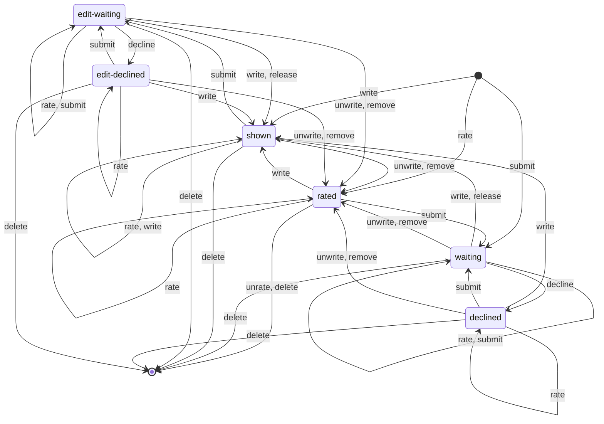

# Stars and reviews: how they work

What people think of a title: their stars, 1 to 5, and a few words if they like. They're for everyone who may see the
library while `[reviews] who` in `settings.toml` has them on; off by default. The help page's *Stars and reviews* says
how to use them; this says how they're made, as a lesson in a small state machine.

## The rules are a table

`reviews.py` holds them as `STEPS`: in a state, an event leads to another state, or isn't allowed there. `step()`
applies one event to one person's review of one title and does nothing else: no files, no clock. So the tests can try
every state with every event (`tests/test_reviews.py`), and a review can only be in a state the table can reach.

The picture below is drawn from the table itself (`reviews.diagram()`); a test fails if the two differ, so it can't
drift from the rules. `[*]` is nothing kept.

<!-- reviews.diagram() -->

<!-- end -->

- **The writer's events:** `rate`, `unrate`, `write` (the words out at once), `submit` (the words wait for an owner),
  `unwrite` (the words away, the stars kept) and `delete`.
- **An owner's:** `release`, `decline` (with a note only the writer and owners see) and `remove` (the words away).
- **Whether words wait** is the server's to say ([reviews] moderation, and the writer's role): it sends `submit` for
  words that wait and `write` for words that don't, so `step()` needn't know about settings.
- **Words changed since an owner saw them** aren't released or declined: those events carry the version (`rev`) the
  owner saw, and `step()` refuses another.
- **A change to shown words** (`edit-waiting`) keeps the shown words showing while it waits; declined, it stays the
  writer's to see (`edit-declined`).

## Where they're kept

They're in the database, in the table `review`: a row for each person's review of a title, as it now stands. A change
runs the event through `step()` and writes the review it makes in the same transaction; the events themselves aren't
kept. The rows name their person, so renaming, removing and exporting a person take their reviews along, and
forgetting their places leaves them. Everyone's are read together for a title's details and for the owners' queue.

Taking words away (`unwrite`, `remove`, `delete`) leaves them nowhere: the database overwrites what it changes or
deletes (`secure_delete`), and its WAL is emptied once the change is in, so the words are gone from the files too and
not only from the page. Copies of the database made before still have them: the help page's *What's kept about you*
says which, and for how long.

## Showing them

Others see a review's stars always, and its words only in `shown`, `edit-waiting` (the earlier words) and
`edit-declined`: `reviews.public()`. The writer sees all of their own: `reviews.own()`. Words are cleaned when they come
in (`reviews.clean`: control characters, the marks that override or isolate the direction of the text, the zero-width
space and U+FEFF go, while the two joiners emoji and Persian need, U+200C and U+200D, stay; 1,000 characters at most) and
are set in the page as text, never as HTML. A report's comment is cleaned by the same function. The page holds its
forms to the limits kept here and in `reports.py` (`TEXT_MAX` for the words, `NOTE_MAX` for an owner's note,
`reports.MOST_WORDS` for a report's comment) and offers `reports.REASONS` in their order, all as `/api/session` sends
them: it keeps no copy of its own, so a limit or a reason changed here is the page's at once.
